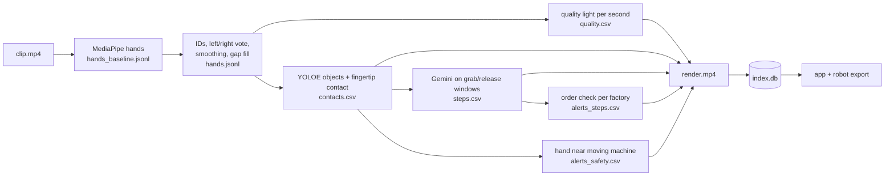

# EgoVision Data Engine

**1st Runner-up (2nd place), BIOS Hackathon 2026, Thapar Institute, Patiala.** FORGE track, problem set by
Mytron Labs. Built in the 24-hour on-site final, 31 Oct to 1 Nov 2026, by team Caffeinated Nerds.

Turns raw head-camera factory video into graded, robot-ready hand data on a laptop CPU. Every second of video
gets a green / yellow / red quality light with reasons; hands, grab and release contacts and task steps are
reviewed in one app and exported as a LeRobot-style robot training dataset. Red footage is never exported.

> This is my copy of the team repository [GunagyeJain/bios-finals](https://github.com/GunagyeJain/bios-finals),
> with the full commit history. Every commit is still credited to the teammate who wrote it.

## The problem
Mytron Labs builds egocentric (first-person) datasets for robotics. We were given 40 unlabelled clips from
cameras on factory workers' heads: about 2 hours from 4 factories, with motion blur, gloves, harsh light, hands
leaving the frame and a camera that never stops moving. Today this kind of data is labelled by hand, which is
slow and expensive. The task was to automate it on an ordinary laptop.

The organisers offered five problem statements: hand tracking (PS1), hand-object contact (PS2), a task-step
timeline (PS3), 3D hands (PS4) and open innovation (PS5). We built PS5 on top of PS1, using PS2 contacts and PS3
steps. Most teams stopped at drawing hand points; we also asked whether a second of footage can be trusted, and
what a data company could actually sell from it.

## Pipeline


1. **Hands:** MediaPipe, plus our fixes: stable IDs, left/right voting, two-way smoothing and gap filling.
2. **Data Health light:** green / yellow / red for every second, with the reason. It grades the footage,
   never the worker.
3. **Contacts:** YOLOE open-vocabulary object detection and a fingertip rule give grab and release per hand.
4. **Steps:** Gemini captions short grab/release windows (faces blurred first), then a step-order check per factory.
5. **Robot view:** a 2-finger gripper or 5-finger hand drawn over the worker's hand, coloured by whether that
   robot type could copy the grab.
6. **Review app** (Streamlit) and **export** to a LeRobot-style dataset: Parquet + video + `datasheet.md`,
   green seconds only, faces blurred.

Each stage reads files and writes files; an existing output is skipped, so runs are resumable. Formats:
[`docs/05-solution/data-schema.md`](docs/05-solution/data-schema.md). Design:
[`docs/05-solution/trd.md`](docs/05-solution/trd.md).

## Results
Measured by us on 152 frames we labelled by hand, across 3 clips. Baseline is plain MediaPipe.

| | Baseline | Ours |
|---|---|---|
| Hands found | 41.2% | 66.1% |
| Detections that are real hands | 87.8% | 90.0% |
| Keypoints within 20% (misses count) | 34.9% | 49.5% |
| Left/right swaps per minute | 57.3 | 4.7 |
| Jitter | 9.4 px | 6.2 px |

Across all 40 clips, 59% of seconds graded green, 16% yellow and 25% red.

What did not improve, and what is not proven:
- Left/right accuracy stayed level (96.7% to 95.5%).
- Keypoint accuracy on hands that were found dropped (85% to 74.5%), because the extra hands we now find are
  the hard ones.
- Gloves and dark frames are unmeasured. The light itself is not yet validated: only one labelled frame falls
  on a red second.
- The robot-fit figure (a 2-finger gripper "can copy" 44.5% of 3,990 grabs) is a rule's output, not a
  validated result.
- Cut after testing: safety alerts (false alarms from weak object boxes), an audio cross-check of grabs, and
  GPU hand models.

How the labels were made: `python -m egovision.eval.label_tool --clip <clip> --labeller <name> --web` picks
60% hard frames and 40% random ones. Points were pre-filled by rtmlib (RTMPose hand) and every frame was checked
by a person; a shared 30-frame set per labeller is fully hand-made, to check whether pre-filling biased the
numbers. Labels are coordinates only (`eval/labels/`). The app's **Metrics** page recomputes everything from
`outputs/<clip>/metrics.json`.

## Who built what
| Name | GitHub | Built |
|---|---|---|
| Gunagye Jain | [@GunagyeJain](https://github.com/GunagyeJain) | Core pipeline, contacts, render, export, app, Metrics page, integration |
| Abhijay Nagal | | Hand tracking and metrics |
| Bhavyam Misra | [@bhavyammisra](https://github.com/bhavyammisra) | Data Health light, face redaction, safety alerts, capture feedback, robot view |
| Shefali Sharma | [@shefali1702](https://github.com/shefali1702) | Label tool, step captions, order check, README, pitch |

### My part
- **Data Health light** (`quality/light.py`): per-second checks for sharpness relative to each clip, head speed
  from optical flow, dark or clipped brightness, frozen frames, hands visible, hands cut at the frame edge and
  camera angle, turned into red / yellow / green with reasons, with tests. Graded all 40 clips: 59 / 16 / 25%
  on our hands, against 53 / 14 / 34% on raw MediaPipe hands.
- **Face redaction** (`quality/redact.py`): OpenCV YuNet blur that keeps hands sharp, applied to every export
  and every window sent to Gemini. Rebuilt after the first version failed video review, with upscaled detection,
  face tracking across frames and a whole-clip scan; blur flicker went from 277 flashes to 2 on 3 clips.
- **Safety alerts** (`safety/run.py`): a fingertip-near-moving-machine rule. Checking 15 real alerts by eye
  showed false alarms from weak object boxes, so I took safety out of the demo.
- **Capture feedback** (`quality/feedback.py`): a per-clip datasheet line such as "camera too high 40%".
- **Robot view** overlays, hand-recovery experiments (ROI re-detection with an rtmlib fallback found 137 of 160
  hidden hands; reverted from the final pipeline for stability), and the business and legal sections of the pitch.

## Setup
Python 3.11 and git.
```bash
git clone https://github.com/bhavyammisra/egovision-data-engine.git && cd egovision-data-engine
python3.11 -m venv .venv && source .venv/bin/activate     # Windows: .venv\Scripts\activate
pip install -r requirements.txt
pip install -e .
sh scripts/setup.sh                                        # commit hooks (block footage in git)
python scripts/check_env.py                                # every line should say OK
```
The footage is not in this repository and cannot be shared (see Data rules). To run the pipeline, put your own
egocentric clips at `data/egohack-data/clips_480p/` (git-ignored). Step captions need
`export GEMINI_API_KEY=...`; without it every stage still runs and steps fall back to grab/release windows.

```bash
python -m egovision run --all      # every stage on every clip, written to outputs/<clip>/ (resumable)
python -m egovision index          # builds outputs/index.db for the app
streamlit run app/Home.py          # review app
python -m egovision export --name demo --light green   # robot dataset
```
One stage, one clip: `python -m egovision run --clip <clip> --stage <stage> --force`.

## The app
| Screen | Shows |
|---|---|
| Library | Every clip with its light share, hands found and alert count; a factory scorecard |
| Clip review | Rendered video with a Baseline / Ours toggle; timeline of light, grab/release per hand, steps and alerts |
| Export | Filters (light, factory, grip, task), preview of episodes and minutes, build dataset, datasheet |
| Metrics | Baseline vs ours on our labelled frames, accuracy per light colour, FPS, failure cases |

## Robot dataset (`exports/<name>/`, git-ignored)
```
meta/info.json          fps, episodes, frames, features and shapes, source clips, pipeline version
meta/episodes.jsonl     episode, clip, t_start, t_end, frames, task, light share, grip types, steps
meta/tasks.jsonl        task_index, task ("verb object" from steps)
data/chunk-000/episode_000000.parquet      one row per frame
videos/chunk-000/egocentric/episode_000000.mp4   faces blurred
datasheet.md            what, how, numbers, limits, licences, hardware
```
Episodes are green time of 3 s or more, split at step boundaries; yellow only with `--light yellow`; red is
never exported.

## Data rules
- The footage belongs to the company that provided it and was used only for this hackathon, under a data-use
  agreement. No videos, frames or screenshots of it appear in this repository or anywhere else we publish.
- `data/egohack-data/`, `outputs/` and `exports/` are git-ignored, and the commit hooks and CI block media files.
- Faces were blurred in every export and in every window sent to the Gemini API.
- Every copy of the footage and outputs was deleted when the event ended
  ([`docs/06-plan/data-deletion.md`](docs/06-plan/data-deletion.md)).

## Licences
| Component | Licence |
|---|---|
| Footage | Owned by the company that provided it; not included, not redistributable |
| MediaPipe Hand Landmarker | Apache-2.0 |
| rtmlib / RTMPose | Apache-2.0 |
| YOLOE (Ultralytics) | AGPL-3.0 |
| YuNet face detector (OpenCV Zoo) | MIT |

Other libraries and APIs: Google Gemini API, OpenCV, NumPy, SciPy, pandas, PyArrow, ONNX Runtime, Streamlit,
Plotly, pytest. Full list: [`requirements.txt`](requirements.txt). Team workflow:
[`CONTRIBUTING.md`](CONTRIBUTING.md).

## Stack
Python, MediaPipe, OpenCV (YuNet, optical flow), YOLOE (Ultralytics), rtmlib / RTMPose, ONNX Runtime, Gemini API,
pandas, PyArrow / Parquet, Streamlit, Plotly, pytest, GitHub Actions.
